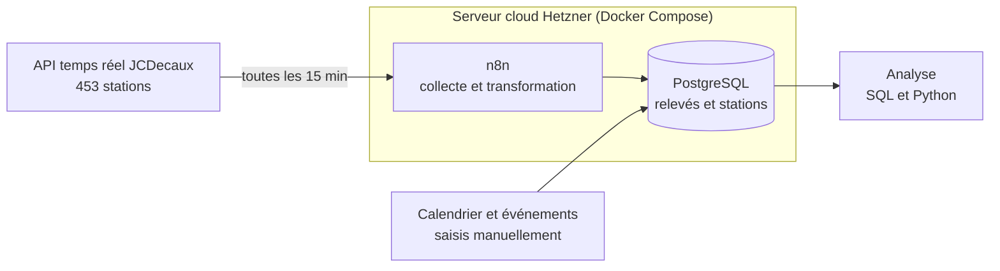

# Analyse de l'usage des vélos en libre-service VélôToulouse

Projet personnel de data engineering et d'analyse de données : collecte automatisée de la disponibilité des 453 stations VélôToulouse, pour étudier comment l'usage des vélos varie selon l'heure, le jour, les vacances, les jours fériés ou les événements.

**Statut** : collecte en cours. Période d'étude : du 12 octobre 2026 au 12 janvier 2027 (relevés toutes les 15 minutes). Analyse à venir.

## Objectif

Comprendre les dynamiques d'utilisation des vélos en libre-service à Toulouse, afin d'identifier les stations sous tension et les facteurs qui influencent la disponibilité des vélos.

## Questions d'étude

**Rythmes temporels**
- Comment la disponibilité évolue-t-elle au fil de la journée (par tranches de 30 minutes) et selon le jour de la semaine ?
- Quelles différences entre la semaine et le week-end, et entre les heures de pointe et les heures creuses ?

**Effets du calendrier**
- Les jours fériés (11 novembre, 25 décembre, 1er janvier) se comportent-ils comme des dimanches ?
- Comment l'usage change-t-il pendant les vacances scolaires (Toussaint, Noël) par rapport aux périodes de cours ?
- Les habitudes reviennent-elles à la normale dès la reprise de janvier ?
- Le réveillon du 31 décembre et le soir de Noël modifient-ils les habitudes ?

**Effets des événements**
- Les manifestations modifient-elles l'usage des stations situées à proximité ?
- Les fermetures de stations de métro pour travaux reportent-elles des usagers vers le vélo ?

**Comparaisons entre stations et types de vélos**
- Quelles sont les stations les plus et les moins sollicitées ?
- Les vélos électriques sont-ils utilisés différemment des vélos mécaniques ?
- Selon le quartier et l'heure, quelle station offre le plus de chances de trouver une place pour déposer son vélo ?

## Architecture

**Composants**
- **Source** : l'API temps réel JCDecaux, qui donne pour chaque station le nombre de vélos (mécaniques et électriques) et de places libres.
- **Collecte** : un workflow n8n déclenché toutes les 15 minutes interroge l'API, sélectionne les champs utiles et les enregistre dans la base.
- **Stockage** : une base PostgreSQL de quatre tables (relevés, stations, calendrier, événements).
- **Déploiement** : n8n et PostgreSQL tournent dans des conteneurs Docker, sur un serveur cloud Hetzner, pour une collecte continue 24h/24.

**Sécurité**
- n8n et PostgreSQL ne sont pas exposés sur internet : on y accède uniquement par tunnel SSH.
- Les secrets (clé d'API, mots de passe) ne figurent pas dans le dépôt : ils sont stockés dans un fichier `.env` et dans les credentials chiffrés de n8n.

## Données collectées

Environ 43 500 relevés par jour (453 stations × 96 relevés), soit près de 4 millions de lignes sur toute la période d'étude.

| Table | Contenu | Alimentation |
|---|---|---|
| `releves` | Disponibilité de chaque station à chaque relevé | Automatique, toutes les 15 minutes |
| `stations` | Nom, adresse et coordonnées GPS des stations | Automatique (mise à jour si une station apparaît) |
| `calendrier` | Jour de la semaine, week-end, jours fériés, vacances scolaires et universitaires | Pré-remplie |
| `evenements` | Manifestations, fermetures de stations de métro, autres événements, avec leur lieu | Saisie manuelle au fil de la période |

**Principales variables de la table `releves`**

| Variable | Description |
|---|---|
| `releve_at` | Date et heure du relevé |
| `station_id` | Identifiant de la station (lien avec `stations`) |
| `statut` | Station ouverte ou fermée |
| `capacite` | Nombre total d'emplacements |
| `velos` | Vélos disponibles, détaillés en `mecaniques` et `electriques` |
| `places_libres` | Emplacements libres pour déposer un vélo |
| `last_update` | Dernière mise à jour de la station côté JCDecaux |

**Limite importante** : l'API indique le nombre de vélos présents à un instant donné, et non le nombre de locations. L'activité des stations sera donc estimée à partir des variations de disponibilité entre deux relevés, ce qui sous-estime les trajets courts et peut être perturbé par les opérations de rééquilibrage des vélos.

